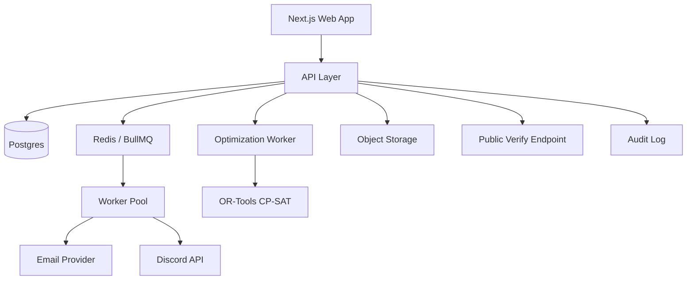
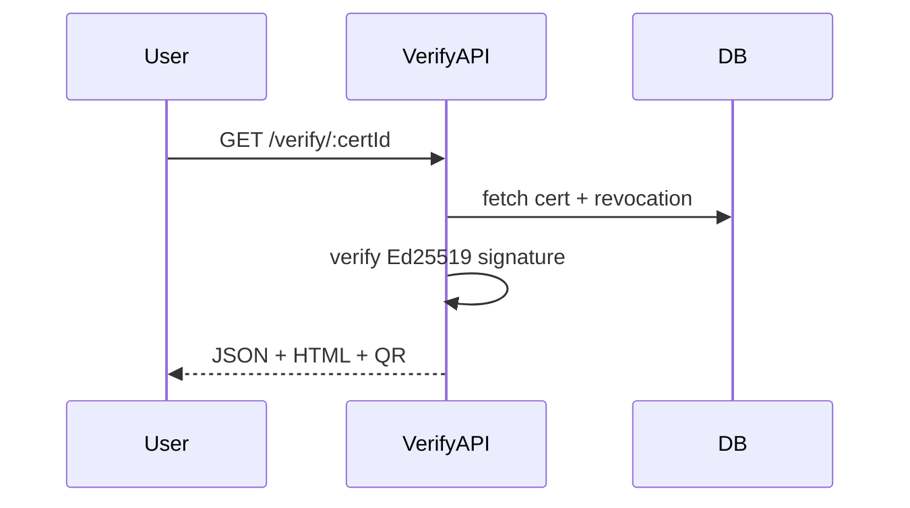
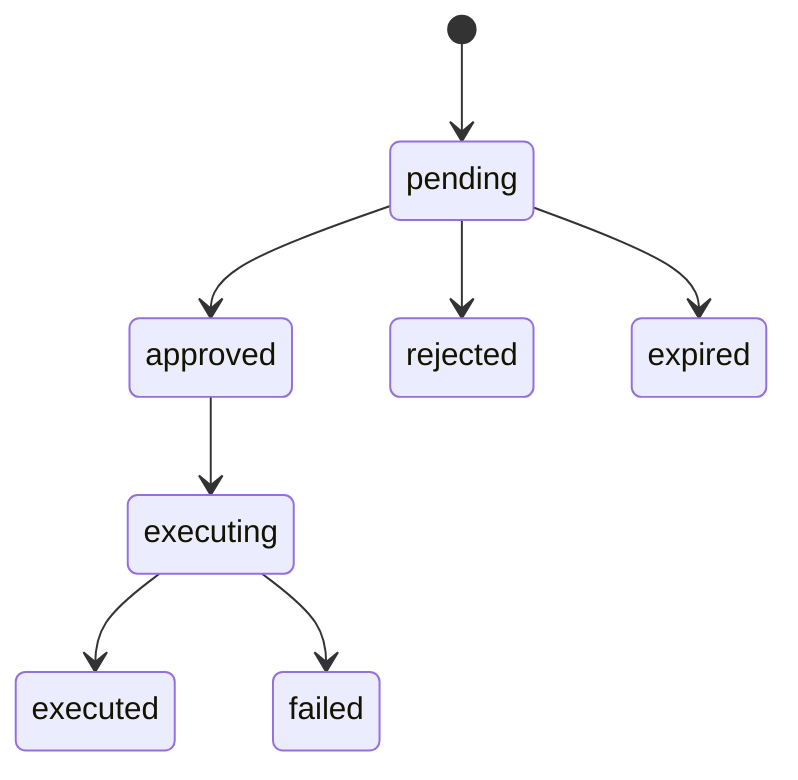

# CommunityOps — Full Implementation Plan

**Version:** 1.0  
**Status:** Draft for build  
**Owner:** Engineering + Program Ops  
**Last updated:** 2026-10-01

> **Note on the original pitch:** The sentence “Its real advantage is that you can...” is completed here as:  
> **“Its real advantage is that you can make high-stakes community operations fair, auditable, and repeatable without scaling headcount.”**

---

## Table of Contents

1. [Executive Summary](#1-executive-summary)
2. [Goals, Non-Goals, Principles](#2-goals-non-goals-principles)
3. [Users and Roles](#3-users-and-roles)
4. [System Architecture](#4-system-architecture)
5. [Core Domain Modules](#5-core-domain-modules)
6. [Detailed Engineering for Five High-Ceiling Pieces](#6-detailed-engineering-for-five-high-ceiling-pieces)
7. [Data Model](#7-data-model)
8. [API Surface](#8-api-surface)
9. [Frontend Plan](#9-frontend-plan)
10. [Security and Compliance](#10-security-and-compliance)
11. [Testing Strategy](#11-testing-strategy)
12. [Observability and Operations](#12-observability-and-operations)
13. [Deployment and Infrastructure](#13-deployment-and-infrastructure)
14. [Delivery Plan and Roadmap](#14-delivery-plan-and-roadmap)
15. [Team and Budget Assumptions](#15-team-and-budget-assumptions)
16. [Success Metrics](#16-success-metrics)
17. [Risks and Mitigations](#17-risks-and-mitigations)
18. [Appendices](#18-appendices)

---

## 1. Executive Summary

CommunityOps is an operations platform for hackathons, cohorts, accelerators, grants, and community programs. It manages applications, team formation, mentor matching, judging, results, bulk communications, certificates, approvals, and audit trails.

The product is not just forms, emails, and a spreadsheet. Its technical ceiling is raised by five engineering investments:

1. **Judging engine** with judge-bias normalization, conflict-of-interest checks, and explainable results.
2. **Team formation and mentor matching** as optimization problems solved in code, not by an LLM.
3. **Outbox pattern** for bulk communication, making email and Discord actions idempotent and rate-limited.
4. **Verifiable certificates** with signed IDs and a public verification endpoint.
5. **Approval gates** on irreversible actions: publishing teams, publishing results, bulk sends, and certificate issuance.

The real advantage is that high-stakes community operations become fair, auditable, and repeatable without scaling headcount.

---

## 2. Goals, Non-Goals, Principles

### 2.1 Goals

- Reduce manual operations time for program managers.
- Make judging fair, transparent, and defensible.
- Form balanced teams and match mentors using constrained optimization.
- Send bulk email and Discord messages reliably, idempotently, and within rate limits.
- Issue certificates that can be verified publicly without trusting a database alone.
- Prevent irreversible mistakes with approval gates, dry runs, and audit logs.
- Support multiple programs, cohorts, and templates.

### 2.2 Non-Goals for v1

- Custom website builder.
- Full CRM.
- Payments and billing.
- Complex public social network.
- Native mobile apps.
- AI chatbot for operations.
- Replacing human judgment with LLMs.

### 2.3 Principles

- **Deterministic over probabilistic** for high-stakes operations.
- **Auditable by default**: every important action writes an audit log.
- **Idempotent by design**: retries must not duplicate side effects.
- **Explainable results**: judges, teams, and matches must show reasoning.
- **Approval before irreversible action**.
- **Modular monolith first**, extract services only when needed.
- **Privacy and least privilege**.

---

## 3. Users and Roles

| Role | Description | Key Permissions |
|---|---|---|
| Admin | System owner | Manage programs, users, approvals, keys, audit |
| Program Manager | Runs a program | Configure program, import participants, form teams, send comms, request approvals |
| Judge | Scores submissions | View assigned submissions, submit scores, declare COI |
| Mentor | Mentors teams | View assigned teams, communicate, submit availability |
| Participant | Program participant | Apply, view team, submit project, receive comms, verify certificate |
| Public Verifier | Anyone with certificate ID | Verify certificate authenticity |

### RBAC Model

- Roles are scoped to programs where possible.
- Permissions are checked at API and UI levels.
- High-risk actions require both permission and approval.

---

## 4. System Architecture

### 4.1 Architecture Style

Start as a **modular monolith** with one separate **optimization worker**.

- **Web app**: Next.js + React + Tailwind.
- **API**: tRPC or REST with Zod validation.
- **Database**: Postgres.
- **ORM**: Prisma or Drizzle.
- **Queue/cache**: Redis + BullMQ.
- **Object storage**: S3/R2.
- **Email**: Resend/SendGrid/SES.
- **Discord**: discord.js bot or webhooks.
- **Auth**: Clerk/Auth.js with RBAC.
- **Optimization worker**: Python FastAPI + OR-Tools CP-SAT.
- **Infra**: Vercel/Fly/Render + Neon/Supabase + Upstash.
- **Observability**: Sentry, Axiom/Logtail, OpenTelemetry.

### 4.2 High-Level Diagram



### 4.3 Environments

- Local
- Staging
- Production
- Preview per pull request

Each environment has isolated database, Redis, object storage bucket, and provider keys.

---

## 5. Core Domain Modules

1. Identity and RBAC
2. Program configuration
3. Applications and forms
4. Participants and teams
5. Mentor matching
6. Judging engine
7. Communications and outbox
8. Certificates and verification
9. Approvals and audit
10. Public verification endpoint

---

## 6. Detailed Engineering for Five High-Ceiling Pieces

### 6.1 A. Judging Engine

#### 6.1.1 Data Model

- `rubrics(id, program_id, name, version)`
- `criteria(id, rubric_id, name, weight, max_score)`
- `judge_assignments(id, judge_id, submission_id, status, assigned_at)`
- `scores(id, judge_id, submission_id, criterion_id, raw_score, comment)`
- `conflicts_of_interest(id, judge_id, participant_id, team_id, org_id, reason)`
- `normalized_scores(id, submission_id, judge_id, criterion_id, z_score, weighted_score)`
- `results(id, program_id, submission_id, final_score, rank, published_at)`

#### 6.1.2 Flow

1. Submissions are locked.
2. Assign judges using balanced min-cost max-flow, excluding COI.
3. Judges score submissions.
4. Normalize per judge:
   - Compute judge mean and standard deviation across submissions.
   - Convert raw scores to z-scores.
   - Apply rubric weights.
   - Optional rank aggregation with Borda or Bradley-Terry if scores are ordinal.
5. Detect outliers and low-confidence judges.
6. Produce explainable result: raw score, normalized score, weight, rank, judge variance, COI exclusions.
7. Publish only after approval gate.

#### 6.1.3 Normalization Formula

For judge \(j\) and criterion \(c\):

\[
z_{j,c} = \frac{x_{j,c} - \mu_{j,c}}{\sigma_{j,c}}
\]

Then weighted score:

\[
S = \sum_c w_c \cdot z_{j,c}
\]

If \(\sigma_{j,c} = 0\), fall back to raw score or mark as low confidence.

#### 6.1.4 Conflict-of-Interest Checks

- Same organization or email domain.
- Prior mentor/mentee relationship.
- Co-author or teammate.
- Declared conflict.
- Manual admin override with audit log.

#### 6.1.5 Explainability Endpoint

`GET /submissions/:id/scorecard`

Returns per-criterion breakdown, normalization math, judge variance, and COI exclusions.

#### 6.1.6 Approval Gate

Publishing results requires approval. Dry-run preview shows rank changes and edge cases.

---

### 6.2 B. Team Formation and Mentor Matching

#### 6.2.1 Inputs

- Participant skills, roles, timezone, preferences.
- Team size min/max.
- Required roles/skills.
- Diversity constraints.
- Conflict pairs.
- Mentor capacity and expertise tags.

#### 6.2.2 Team Formation as Constrained Optimization

Use **OR-Tools CP-SAT** or simulated annealing for large groups.

**Objective:** Maximize:

- Skill coverage
- Preference satisfaction
- Timezone overlap
- Role balance
- Diversity score

Minimize:

- Conflict penalties
- Team size imbalance
- Missing critical skills

**Constraints:**

- Each participant on exactly one team.
- Team size bounds.
- Required roles per team.
- No conflict pairs together.
- Mentor capacity respected.

#### 6.2.3 Mentor Matching

Model as min-cost bipartite matching:

- Left: teams.
- Right: mentors.
- Edge cost: expertise mismatch + timezone penalty + capacity penalty.
- Solve with Hungarian algorithm or min-cost max-flow.

#### 6.2.4 Output and Explainability

Preview with explanations:

> Team 4 matched with Mentor A because 92% skill overlap, same timezone, capacity available.

#### 6.2.5 Approval Gate

Publishing teams is irreversible until manually reopened. Requires dry-run diff and approval.

---

### 6.3 C. Outbox Pattern for Bulk Communication

#### 6.3.1 Outbox Table

```sql
outbox_events (
  id uuid primary key,
  aggregate_type text,
  aggregate_id uuid,
  event_type text,
  payload jsonb,
  idempotency_key text unique,
  status text, -- queued, processing, sent, failed, dead
  attempts int,
  available_at timestamptz,
  processed_at timestamptz,
  created_at timestamptz
);
```

#### 6.3.2 Worker Flow

1. Domain action writes business row + outbox event in same transaction.
2. Worker claims jobs with `SELECT ... FOR UPDATE SKIP LOCKED`.
3. Sends via channel adapter.
4. Marks sent or schedules retry with exponential backoff.
5. Failed after N attempts goes to DLQ.

```mermaid
sequenceDiagram
  participant App
  participant DB
  participant Worker
  participant Provider
  App->>DB: BEGIN; write business row + outbox event; COMMIT
  Worker->>DB: claim job FOR UPDATE SKIP LOCKED
  Worker->>Provider: send message
  Provider-->>Worker: success/failure
  Worker->>DB: mark sent or retry
```

#### 6.3.3 Channel Adapters

- Email: Resend/SendGrid/SES.
- Discord: bot DM, channel message, or webhook.
- Slack/WhatsApp later.

#### 6.3.4 Rate Limiting

- Token bucket per provider and per program.
- Respect provider limits.
- Batch sends with preview and test send.

#### 6.3.5 Idempotency

Every campaign has an idempotency key. Re-running does not duplicate sends.

#### 6.3.6 Approval Gate

Bulk sends require approval. Show recipient count, template preview, and exclusions.

---

### 6.4 D. Verifiable Certificates

#### 6.4.1 Design

- Certificate ID: UUIDv7 + base58 check.
- Signed payload with Ed25519 private key.
- Canonical JSON payload.
- Store certificate hash and signature.
- Public endpoint: `GET /verify/:certId`.
- Returns JSON + HTML page + QR code.
- Optional Open Badges 3.0 / W3C Verifiable Credentials.
- Key rotation supported.
- Revocation list checked at verification time.

#### 6.4.2 Canonical Payload

```json
{
  "cert_id": "...",
  "recipient_name": "...",
  "recipient_email_hash": "...",
  "program": "...",
  "role": "winner|participant|mentor|judge",
  "issued_at": "...",
  "template_version": "...",
  "revoked": false
}
```

#### 6.4.3 Verification Flow



#### 6.4.4 Approval Gate

Issuing certificates requires approval. Preview recipient list first.

---

### 6.5 E. Approval Gates on Irreversible Actions

#### 6.5.1 Irreversible Actions

- Publish teams.
- Publish results.
- Bulk sends.
- Issue certificates.

#### 6.5.2 Approval Model

```sql
approvals (
  id uuid primary key,
  action_type text,
  target_type text,
  target_id uuid,
  requested_by uuid,
  approved_by uuid,
  status text, -- pending, approved, rejected, expired
  diff jsonb,
  expires_at timestamptz,
  created_at timestamptz
);
```

#### 6.5.3 Rules

- Default: one program manager + one admin for high-risk actions.
- Dry-run preview required.
- Snapshot diff shown before approval.
- Execution is idempotent.
- Every approval and execution writes to `audit_logs`.

#### 6.5.4 State Machine



---

## 7. Data Model

### 7.1 Core Tables

- `users`
- `roles`
- `programs`
- `program_members`
- `participants`
- `applications`
- `application_answers`
- `teams`
- `team_members`
- `mentors`
- `mentor_assignments`
- `submissions`
- `rubrics`
- `criteria`
- `judge_assignments`
- `scores`
- `conflicts_of_interest`
- `results`
- `comm_templates`
- `comm_campaigns`
- `outbox_events`
- `message_deliveries`
- `certificates`
- `certificate_revocations`
- `approvals`
- `audit_logs`

All tables include `created_at`, `updated_at`, and `created_by` where relevant.

### 7.2 Key Relationships

- A `program` has many `participants`, `teams`, `submissions`, `rubrics`, `campaigns`, and `certificates`.
- A `team` has many `team_members`.
- A `submission` belongs to a `team` or `participant`.
- A `rubric` has many `criteria`.
- A `judge_assignment` links a judge to a submission.
- A `score` links a judge, submission, and criterion.
- An `approval` links to a target action.
- An `audit_log` records actor, action, target, before/after diff, timestamp.

---

## 8. API Surface

### 8.1 Programs

- `POST /programs`
- `GET /programs`
- `GET /programs/:id`
- `PATCH /programs/:id`

### 8.2 Applications

- `POST /programs/:id/applications/import`
- `GET /programs/:id/applications`
- `GET /applications/:id`

### 8.3 Teams

- `POST /programs/:id/teams/generate` — preview only
- `POST /programs/:id/teams/publish` — approval required
- `GET /programs/:id/teams`

### 8.4 Mentors

- `POST /programs/:id/mentors/match`
- `GET /programs/:id/mentor-assignments`

### 8.5 Judging

- `POST /programs/:id/judging/assign`
- `POST /submissions/:id/scores`
- `GET /submissions/:id/scorecard`
- `POST /programs/:id/results/compute`
- `POST /programs/:id/results/publish` — approval required

### 8.6 Communications

- `POST /communications/campaigns`
- `POST /communications/campaigns/:id/send` — approval required
- `GET /communications/campaigns/:id/deliveries`

### 8.7 Certificates

- `POST /programs/:id/certificates/issue` — approval required
- `GET /verify/:certId`
- `POST /certificates/:id/revoke`

### 8.8 Audit and Approvals

- `GET /approvals`
- `POST /approvals/:id/approve`
- `POST /approvals/:id/reject`
- `GET /audit`

---

## 9. Frontend Plan

### 9.1 Key Pages

- Dashboard
- Program settings
- Applications import
- Participants list
- Team formation preview
- Team publish approval
- Mentor matching preview
- Judging assignments
- Scorecard view
- Results preview and publish
- Communications campaign builder
- Campaign send approval
- Certificate issuance
- Public verification page
- Audit log

### 9.2 UX Rules

- Show dry-run previews before irreversible actions.
- Show recipient counts and exclusions before sends.
- Show normalization math in scorecards.
- Show conflict-of-interest warnings clearly.
- Require typed confirmation for high-risk actions.

---

## 10. Security and Compliance

- OWASP Top 10 protections.
- RBAC tests per role.
- Signed certificate key rotation.
- Audit logs append-only.
- Rate limiting and abuse protection.
- PII minimization and export/delete workflows.
- Secrets in managed vault.
- Encryption at rest and in transit.
- Signed webhooks where supported.

---

## 11. Testing Strategy

### 11.1 Unit Tests

- Normalization math.
- Optimization constraints.
- Approval state transitions.
- Certificate signing and verification.

### 11.2 Property Tests

- Outbox idempotency.
- Retry behavior.
- Rate limiting.

### 11.3 Integration Tests

- COI checks.
- Approval gates.
- Email and Discord adapters.
- Public verification endpoint.

### 11.4 E2E Tests

- Playwright flows for program manager, judge, mentor, participant.
- Certificate verification flow.

### 11.5 Load Tests

- Bulk sends.
- Verification endpoint.
- Judging score ingestion.

---

## 12. Observability and Operations

### 12.1 Metrics

- Queue depth.
- Send latency.
- Failure rate.
- DLQ size.
- Judge variance.
- Team formation runtime.
- Certificate verification success rate.

### 12.2 Logs

- Structured JSON logs.
- Correlation IDs.
- Audit logs immutable.

### 12.3 Alerts

- DLQ above threshold.
- Provider failure spike.
- Approval gate bypass attempt.
- Certificate key error.
- Database replication lag.

### 12.4 Runbooks

- Retry DLQ.
- Rotate certificate keys.
- Recover failed bulk send.
- Roll back published results.
- Restore from backup.

---

## 13. Deployment and Infrastructure

### 13.1 CI/CD

- GitHub Actions.
- Lint, typecheck, test, build.
- Migrations gated.
- Preview environments per PR.

### 13.2 Infrastructure

- Vercel/Fly/Render for app.
- Neon/Supabase for Postgres.
- Upstash for Redis.
- S3/R2 for object storage.
- Separate optimization worker service.

### 13.3 Backups

- Daily database backups.
- Point-in-time recovery.
- Quarterly restore drills.
- Object storage versioning.

---

## 14. Delivery Plan and Roadmap

| Phase | Focus | Duration | Deliverables |
|---|---|---|---|
| 0 | Foundations | 1–2 weeks | Auth, RBAC, program CRUD, audit log, CI/CD, environments |
| 1 | Applications & participants | 2 weeks | Forms, CSV import, participant profiles, basic email |
| 2 | Team formation & mentor matching | 2–3 weeks | Constraints, OR-Tools worker, preview/publish, explanations |
| 3 | Judging engine | 3–4 weeks | Rubrics, judge assignment, COI, normalization, scorecards, results |
| 4 | Outbox & communications | 2–3 weeks | Outbox table, worker, email/Discord adapters, rate limits, templates, preview |
| 5 | Certificates & verification | 2 weeks | Ed25519 signing, QR codes, public verify endpoint, revocation |
| 6 | Approval gates & hardening | 2 weeks | Approvals, dry-run diffs, audit immutability, security, load tests |
| 7 | Pilot | Ongoing | Run one real program, measure ops hours saved, delivery rate, judge fairness, certificate verifications |

**MVP target:** ~10–12 weeks with 1 full-stack engineer, 1 backend/algorithms engineer, and part-time design/PM.

---

## 15. Team and Budget Assumptions

### 15.1 Team

- 1 full-stack engineer
- 1 backend/algorithms engineer
- Part-time product manager
- Part-time designer
- Part-time QA/ops

### 15.2 Budget Categories

- Infrastructure
- Email provider
- Discord bot hosting
- Observability
- Design
- Security review

---

## 16. Success Metrics

- Time to publish teams: days → minutes.
- Time to publish results: hours → minutes.
- Judge bias reduction: variance across judges.
- Email/Discord delivery rate > 98%.
- Certificate verification success rate.
- Ops hours saved per program.
- Participant/mentor satisfaction.

---

## 17. Risks and Mitigations

| Risk | Mitigation |
|---|---|
| Optimization too slow | CP-SAT with time limits + heuristic fallback |
| Judge resistance to normalization | Explainable scorecards + admin override |
| Bulk send provider limits | Outbox + token bucket + retries |
| Certificate key compromise | Key rotation + revocation list |
| Irreversible mistakes | Approval gates + dry-run diffs |
| Scope creep | Freeze v1 to five core modules |
| PII leak | Least privilege, encryption, audit, export/delete workflows |
| Queue backlog | Autoscaling workers, DLQ alerts, rate limits |

---

## 18. Appendices

### Appendix A — Normalization Example

Judge A scores: 70, 80, 90  
Mean = 80, StdDev = 8.16  
Raw 90 → z = 1.22  
Raw 70 → z = -1.22  

Judge B scores: 50, 60, 70  
Mean = 60, StdDev = 8.16  
Raw 70 → z = 1.22  

After normalization, both judges’ top scores align.

### Appendix B — OR-Tools CP-SAT Model Sketch

```python
from ortools.sat.python import cp_model

model = cp_model.CpModel()
# x[p, t] = 1 if participant p is on team t
# constraints: each participant one team, team size bounds
# objective: maximize skill coverage + preference - conflict penalties
solver = cp_model.CpSolver()
solver.parameters.max_time_in_seconds = 10
status = solver.Solve(model)
```

### Appendix C — Outbox Claim SQL

```sql
WITH claimed AS (
  SELECT id
  FROM outbox_events
  WHERE status = 'queued'
    AND available_at <= now()
  ORDER BY available_at
  FOR UPDATE SKIP LOCKED
  LIMIT 10
)
UPDATE outbox_events
SET status = 'processing'
WHERE id IN (SELECT id FROM claimed)
RETURNING *;
```

### Appendix D — Certificate Verification Example

```http
GET /verify/CERT_7f3a9b2c
```

```json
{
  "valid": true,
  "cert_id": "CERT_7f3a9b2c",
  "recipient_name": "Ada Lovelace",
  "program": "Spring Hackathon 2026",
  "role": "winner",
  "issued_at": "2026-10-01T12:00:00Z",
  "revoked": false,
  "signature_verified": true
}
```

### Appendix E — Approval Gate Checklist

- [ ] Dry-run preview generated.
- [ ] Diff shown to approver.
- [ ] Recipient count and exclusions confirmed.
- [ ] Idempotency key present.
- [ ] Approval recorded.
- [ ] Execution logged.
- [ ] Audit log updated.

---

**End of plan.**
