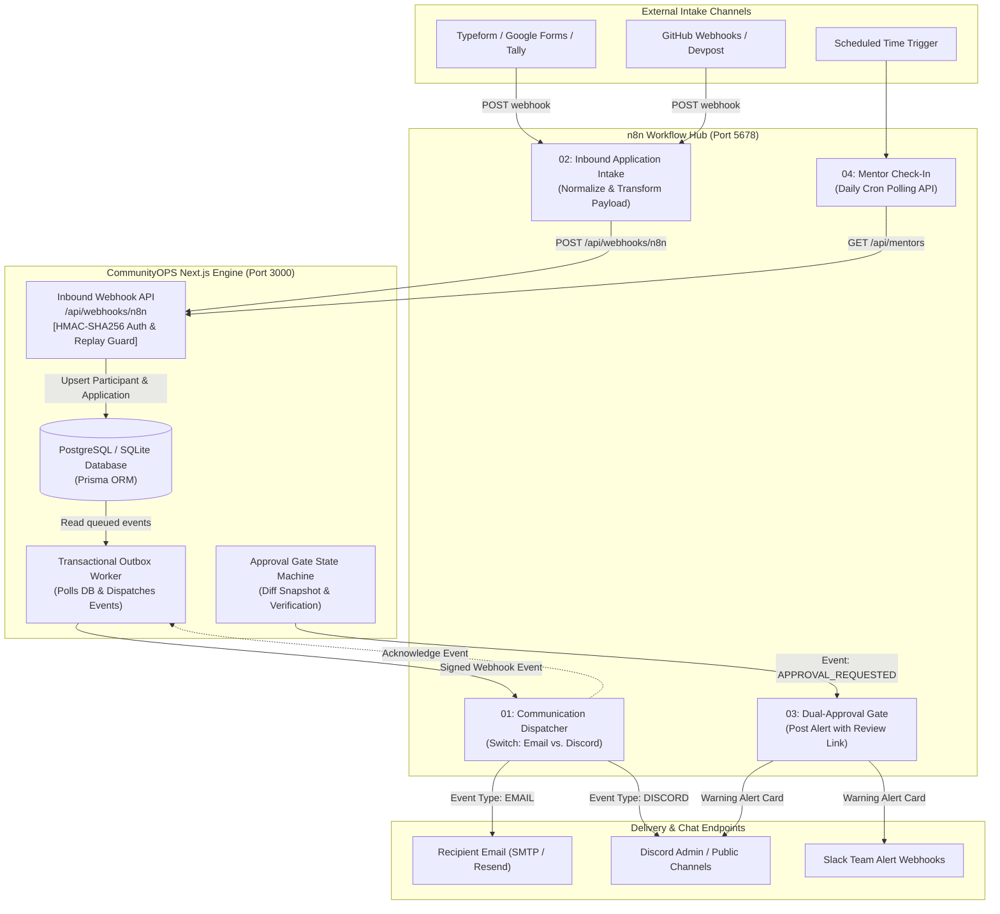
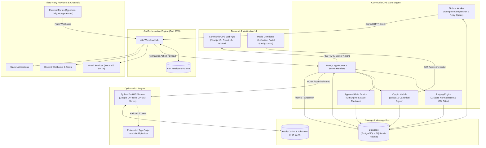

# 🚀 CommunityOPS

> **Make high-stakes community operations fair, auditable, and automated without scaling headcount.**

[](https://github.com/SUBHA22-CODER/ComunityOPS)
[]()
[](https://n8n.io/)
[](https://nextjs.org/)
[](https://react.dev/)
[](https://www.typescriptlang.org/)
[](https://www.prisma.io/)
[](https://developers.google.com/optimization)
[]()
[](https://www.docker.com/)

---

## 💡 One-Line Value Proposition

**CommunityOPS** is an open-source operations management and workflow automation platform that unifies applicant intake, constraint-based team formation, bias-normalized judging, verifiable credentials, and multi-channel communications through an event-driven architecture orchestrated by **n8n**.

---

## 🔍 Why CommunityOPS?

Organizing hackathons, accelerator cohorts, grant rounds, and student fellowships requires managing complex, high-stakes operational workflows. Community teams typically juggle:

- **Fragmented Ingestion & Siloed Tools:** Participant responses get stranded across Typeform, Google Forms, Tally, or Discord with no single source of truth.
- **Biased, Inconsistent Judging:** Subjective judging leads to skewed rankings when lenient judges hand out top scores and strict judges give low scores to equally meritorious projects.
- **Combinatorial Nightmare in Team & Mentor Matching:** Manually pairing hundreds of hackers into balanced teams while respecting skills, timezones, and interpersonal conflicts is intractable without mathematical optimization.
- **Accidental Irreversible Actions:** Prematurely publishing leaderboards, sending broken bulk emails, or allocating grants without multi-admin oversight.
- **Unverifiable & Forged Credentials:** Traditional PDF completion certificates are trivially altered with design software.
- **Unreliable Notifications:** Blast emails and chat announcements without idempotency lead to missed alerts or spam duplication.

**CommunityOPS** eliminates these bottlenecks by coupling a modern Next.js management engine with **n8n workflow orchestration**, **Google OR-Tools CP-SAT constraint solvers**, **Ed25519 cryptographic verification**, and a **Transactional Outbox**.

---

## ✨ Key Features

### ⚡ n8n Workflow Orchestration
- **Bidirectional Ingestion & Dispatch:** n8n acts as the central integration nervous system.
- **Normalized Inbound Webhooks:** Automatically maps varied external form submissions (Typeform, Google Forms, Tally) into canonical applicant records with HMAC-SHA256 signature verification and replay protection.
- **Multi-Channel Dispatcher:** Routes queued Outbox events to Email and Discord with intelligent channel fallback.
- **Interactive Dual-Approval Gates:** Pushes critical action alerts to Slack and Discord with direct dashboard review links.
- **Automated Cron Reminders:** Runs scheduled mentor check-in triggers to fetch active mentors and keep engagement high.

### 🏛 Bias-Normalized Judging Engine (Z-Score)
- **Mathematical Calibration:** Normalizes raw scores per judge $j$ and criterion $c$:
  $$z_{j,c} = \frac{x_{j,c} - \mu_{j,c}}{\sigma_{j,c}}$$
- **Rubric Weighting:** Computes composite scores $S = \sum w_c \cdot z_{j,c}$ to ensure strict and lenient judges have equitable weight.
- **Zero-Variance & Edge Case Handling:** Automatically detects $\sigma = 0$ (judges giving flat scores) and flags low-confidence judging.
- **Conflict of Interest (COI) Filtering:** Automatically filters out judges from the same organization, previous mentorship, or team ties.
- **Explainable Scorecards:** Exposes transparent mathematical breakdowns via `/api/submissions/:id/scorecard`.

### 🧩 Constraint-Based Team & Mentor Matching
- **Dual-Engine Architecture:** High-capacity Python **Google OR-Tools CP-SAT** microservice with an embedded TypeScript heuristic fallback.
- **Multi-Objective Optimization:** Balances technical skill entropy and role diversity while minimizing timezone disparities and honoring conflict constraints.
- **Hungarian Bipartite Allocation:** Matches mentors to teams based on capacity, domain overlap, and timezone compatibility with explainability logs.

### 🛡️ Approval Gates on Irreversible Operations
- **Four-Eyes Principle:** Enforces multi-admin approval for high-risk irreversible actions:
  - `PUBLISH_TEAMS`
  - `PUBLISH_RESULTS`
  - `BULK_SEND`
  - `ISSUE_CERTIFICATES`
- **Snapshot Diff Inspection:** Reviewers can inspect exact dry-run JSON diffs before granting authorization.
- **Strict State Machine:** `pending` → `approved` / `rejected` / `expired` → `executed`.

### 📜 Verifiable Certificates (Ed25519 Cryptography)
- **Tamper-Proof Credentials:** Certificates are deterministically formatted into canonical JSON payloads and signed with an Ed25519 private key.
- **Independent Verification:** Public endpoint (`/verify/:certId` and `/api/verify/:certId`) validates authenticity mathematically using the issuer public key—without needing to trust a raw database record alone.
- **UUIDv7 & Base58 Check:** Collision-resistant, time-ordered certificate identifiers with QR code generation.
- **Revocation Engine:** Instant revocation support with audit logging.

### 📨 Transactional Outbox Pattern
- **Zero-Loss Communications:** Atomically writes business logic updates and `outbox_events` in the exact same database transaction.
- **Idempotency & Deduplication:** Eliminates duplicate email or Discord notifications via unique idempotency keys.
- **Exponential Backoff & DLQ:** Retries transient network failures with backoff and sends permanently failing messages to a Dead Letter Queue (`status = dead`).

---

## ⚡ Powered by n8n

[n8n](https://n8n.io/) serves as the **extensible automation backbone** for CommunityOPS. Rather than writing brittle, hardcoded API connectors for dozens of third-party SaaS tools, CommunityOPS delegates external intake, communication routing, and interactive chat alerts to modular n8n workflows.

### Automation Workflow Architecture



### What n8n Handles in CommunityOPS

1. **Webhook Ingestion & Normalization:** Standardizes varying field names from external forms (`fullName`, `fields`, `email`, `timezone`) into clean JSON payloads for `/api/webhooks/n8n`.
2. **Channel Switching:** Routes Outbox events intelligently through `Switch` nodes to send formatted HTML emails or Discord messages.
3. **Interactive Human-in-the-Loop Triggers:** Pushes formatted warning messages with action metadata to Discord/Slack when an admin requests an irreversible operation.
4. **Scheduled Automations:** Triggers daily cron routines to query active mentors and flag engagement milestones.
5. **Decoupled Failure Handling:** Allows non-technical community managers to inspect workflow execution history, debug failed runs, and retry failed third-party requests directly in the visual n8n canvas.

---

## 📂 n8n Workflow Catalog

All production workflow templates are packaged under [`n8n/workflows/`](file:///c:/Users/Subha%20Prasana%20Parida/OneDrive/Desktop/community%20ops/n8n/workflows/):

| Workflow Name | File | Trigger | Primary Nodes | Integrations | Purpose |
|---|---|---|---|---|---|
| **Multi-Channel Communication Dispatcher** | [`01-communication-dispatcher.json`](file:///c:/Users/Subha%20Prasana%20Parida/OneDrive/Desktop/community%20ops/n8n/workflows/01-communication-dispatcher.json) | Webhook (`POST /webhook/community-ops-events`) | Webhook Trigger → Switch Node → Email / Discord → Respond to Webhook | Email (SMTP), Discord Webhook | Receives Outbox events, routes by event type, and executes reliable multi-channel messaging. |
| **Inbound Application Intake** | [`02-inbound-application-intake.json`](file:///c:/Users/Subha%20Prasana%20Parida/OneDrive/Desktop/community%20ops/n8n/workflows/02-inbound-application-intake.json) | Webhook (`POST /webhook/application-intake`) | Webhook Trigger → JavaScript Code Node (Normalizer) → HTTP Request | Typeform, Tally, Google Forms, CommunityOPS API | Accepts external application submissions, maps arbitrary field structures, and registers the applicant via HMAC-secured API. |
| **Dual Approval Interactive Gate** | [`03-dual-approval-slack-discord.json`](file:///c:/Users/Subha%20Prasana%20Parida/OneDrive/Desktop/community%20ops/n8n/workflows/03-dual-approval-slack-discord.json) | Webhook (`POST /webhook/approval-gate-trigger`) | Webhook Trigger → Discord Alert Node | Discord, Slack | Pushes real-time alerts into admin channels whenever an irreversible action is initiated, including direct review links. |
| **Scheduled Mentor Check-In & Reminders** | [`04-mentor-reminder-checkin.json`](file:///c:/Users/Subha%20Prasana%20Parida/OneDrive/Desktop/community%20ops/n8n/workflows/04-mentor-reminder-checkin.json) | Schedule Trigger (Daily) | Schedule Node → HTTP Request (`GET /api/mentors`) | CommunityOPS API | Executes daily health check queries against active mentor rosters to automate mentor support cycles. |

---

### Detailed Workflow Breakdowns

#### 1. Multi-Channel Communication Dispatcher (`01-communication-dispatcher.json`)
- **Purpose:** Centralized dispatch worker for Outbox events created by campaigns or program milestones.
- **Trigger:** Webhook listening on path `community-ops-events`.
- **Flow:**
  ```text
  [Webhook Trigger] ──► [Switch: eventType] ┬──► [Send Email Notification] ──► [Respond to CommunityOps]
                                            └──► [Send Discord Notification] ─┘
  ```
- **Integrations:** n8n Email Node (`n8n-nodes-base.emailSend`), Discord Node (`n8n-nodes-base.discord`), CommunityOps Outbox API.
- **Outcome:** Messages are sent to the correct recipient medium; n8n responds synchronously with `{ received: true, eventId, status: "dispatched" }`.

#### 2. Inbound Application Intake (`02-inbound-application-intake.json`)
- **Purpose:** Ingests applicant submissions from external form tools without writing custom webhook listeners in your application code.
- **Trigger:** Webhook listening on path `application-intake`.
- **Flow:**
  ```text
  [Form Webhook In] ──► [JavaScript Code Node: Normalize Fields] ──► [HTTP Request: POST /api/webhooks/n8n]
  ```
- **Integrations:** Typeform, Google Forms, Tally, CommunityOps Webhook Ingestion Hub.
- **Outcome:** Extracts `name`, `email`, `skills`, `rolePref`, and `timezone`, constructs an `ingest_application` payload, attaches the secret header `X-Webhook-Secret`, and posts to CommunityOPS.

#### 3. Dual Approval Interactive Gate (`03-dual-approval-slack-discord.json`)
- **Purpose:** Sends security alerts whenever sensitive operations are staged.
- **Trigger:** Webhook listening on path `approval-gate-trigger`.
- **Flow:**
  ```text
  [Approval Webhook In] ──► [Post Warning Alert to Admin Channel]
  ```
- **Integrations:** Discord API / Slack Incoming Webhooks.
- **Outcome:** Broadcasts action type, target type, requester ID, idempotency key, and direct approval links into private admin operations channels.

#### 4. Scheduled Mentor Check-In & Reminders (`04-mentor-reminder-checkin.json`)
- **Purpose:** Automates daily mentor roster monitoring.
- **Trigger:** Built-in n8n Schedule Trigger (`interval: 1 day`).
- **Flow:**
  ```text
  [Daily Schedule Trigger] ──► [HTTP Request: GET /api/mentors]
  ```
- **Integrations:** CommunityOPS REST API.
- **Outcome:** Periodically checks mentor capacity and assignment statuses to keep hackathon mentor desks running smoothly.

---

## 🏗️ System Architecture



---

## 💻 Technology Stack

| Layer | Technology | Purpose in CommunityOPS |
|---|---|---|
| **Frontend Framework** | **Next.js 15.2 (App Router)** | Modern full-stack React framework with server components and streaming |
| **UI Library** | **React 19** | Component rendering and client-side interactions |
| **Styling & Motion** | **Tailwind CSS + Framer Motion** | High-aesthetic responsive styling and micro-animations |
| **Icons & QR** | **Lucide React + qrcode** | Interface iconography and verification QR code rendering |
| **ORM & Database** | **Prisma 6.4 + SQLite / PostgreSQL** | Strongly typed schema modeling and migrations across 25 domain models |
| **Workflow Automation** | **n8n (v1.x latest)** | Visual orchestration, external intake normalization, and outbound dispatching |
| **Constraint Solver** | **Google OR-Tools (CP-SAT)** | High-capacity constraint satisfaction optimization for balanced team formation |
| **Matching Algorithms** | **SciPy / Hungarian Algorithm** | Optimal bipartite mentor matching minimizing timezone and skill gaps |
| **Microservice Framework**| **Python 3.11 + FastAPI** | High-performance API serving the CP-SAT optimizer service |
| **Cryptography** | **Node.js Native `crypto` (Ed25519)** | Asymmetric key generation, canonical JSON hashing, and certificate signing |
| **Message Queue & Cache** | **Redis 7** | Cache store and worker queue backing outbox operations |
| **Containerization** | **Docker & Docker Compose** | Orchestration for PostgreSQL, Redis, n8n, and the Python optimizer |

---

## 📁 Project Structure

```text
ComunityOPS/
├── .env.example                     # Environment template with all connection variables
├── docker-compose.yml               # Multi-service composition (Postgres, Redis, n8n, Optimizer)
├── package.json                     # Node.js dependencies and operational scripts
├── tsconfig.json                    # TypeScript compiler configuration
├── CommunityOps-Implementation-Plan.md # Technical specification & pillar documentation
│
├── prisma/
│   └── schema.prisma                # Core domain schema (25 models across all 5 pillars)
│
├── n8n/                             # Dedicated n8n automation hub
│   ├── README.md                    # n8n quickstart guide and API reference
│   └── workflows/                   # Production-ready importable JSON workflows
│       ├── 01-communication-dispatcher.json
│       ├── 02-inbound-application-intake.json
│       ├── 03-dual-approval-slack-discord.json
│       └── 04-mentor-reminder-checkin.json
│
├── services/
│   └── optimizer/                   # Python FastAPI CP-SAT optimization service
│       ├── Dockerfile               # Container build for optimizer
│       ├── requirements.txt         # ortools, fastapi, uvicorn, scipy, numpy
│       └── main.py                  # CP-SAT team formulation and bipartite mentor solver
│
├── scripts/
│   ├── seed.mjs                     # Complete hackathon seed dataset (judges, teams, rubrics)
│   └── test-pillars.mjs             # End-to-end mathematical & cryptographic validation script
│
├── src/
│   ├── app/                         # Next.js App Router pages and API routes
│   │   ├── page.tsx                 # Executive Command Dashboard
│   │   ├── applications/page.tsx    # Applicant roster, timezone map, and intake portal
│   │   ├── teams/page.tsx           # Constraint solver controls & team formation view
│   │   ├── judging/page.tsx         # Rubric weighting, Z-score rankings & scorecards
│   │   ├── communications/page.tsx  # Outbox queue monitor & campaign dispatcher
│   │   ├── certificates/page.tsx    # Ed25519 certificate authority & issuance manager
│   │   ├── verify/[certId]/page.tsx # Public certificate verification viewer
│   │   ├── approvals/page.tsx       # Dual-authorization diff viewer & audit trail
│   │   │
│   │   └── api/                     # Backend REST API endpoints
│   │       ├── applications/        # Batch applicant registration
│   │       ├── approvals/           # Four-eyes authorization handler
│   │       ├── audit/               # Immutable audit log stream
│   │       ├── certificates/        # Ed25519 certificate creation & revocation
│   │       ├── communications/      # Outbox processing trigger & campaign creator
│   │       ├── judging/             # Z-score execution & leaderboard builder
│   │       ├── mentors/             # Mentor roster & assignments
│   │       ├── programs/            # Program lifecycle operations
│   │       ├── submissions/[id]/scorecard/ # Transparent judging breakdown
│   │       ├── teams/               # Team optimization trigger & status
│   │       ├── verify/[certId]/     # Public cryptographic verification endpoint
│   │       └── webhooks/n8n/        # HMAC-secured inbound n8n ingestion receiver
│   │
│   ├── components/                  # UI components, badges, and layout wrappers
│   └── lib/                         # Core algorithmic and infrastructure libraries
│       ├── approvals.ts             # Approval state machine & diff snapshot generator
│       ├── crypto.ts                # Ed25519 keypair generation, canonical JSON & verify
│       ├── db.ts                    # Prisma database client singleton
│       ├── judging-engine.ts        # Z-score normalization & COI engine
│       ├── n8n.ts                   # HMAC signing, replay protection & outbound webhook caller
│       ├── optimizer-client.ts      # CP-SAT HTTP client with embedded TypeScript fallback
│       └── outbox-worker.ts         # Transactional Outbox processor & channel adapters
```

---

## 🔄 How It Works

```text
1. Form Intake (Typeform / Google Forms)
       │
       ▼
2. n8n Inbound Workflow (Normalizes fields, generates HMAC signature)
       │
       ▼
3. CommunityOPS Inbound Webhook (/api/webhooks/n8n)
   • Verifies HMAC-SHA256 signature and timestamp freshness
   • Stores participant and application in DB
       │
       ▼
4. Constraint Optimization (Team & Mentor Matching)
   • Python OR-Tools CP-SAT balances skill entropy and timezones
   • Hungarian algorithm matches mentors under capacity limits
       │
       ▼
5. Approval Gate (Four-Eyes Principle)
   • Sensitive actions (Publishing teams/results, bulk sending) create dry-run diffs
   • n8n pushes warning notifications into Discord/Slack
   • Second admin reviews diff and authorizes
       │
       ▼
6. Fair Judging & Z-Score Normalization
   • Judges submit rubric scores; engine calibrates harshness
   • Submissions ranked fairly; explainable scorecard generated
       │
       ▼
7. Verifiable Certificates & Outbox Dispatch
   • Ed25519 digital signatures seal credentials
   • Transactional Outbox atomically stages notification events
   • Worker dispatches via n8n to Email and Discord
```

---

## 🛠️ Installation & Setup

### Prerequisites
- **Node.js**: `v18.0.0+` (tested on Node v20 & v24)
- **npm**: `v9.0.0+`
- **Docker & Docker Compose**: (Required for n8n, PostgreSQL, Redis, and OR-Tools microservice)
- *(Optional)* **Python 3.11+**: If running the optimizer microservice locally without Docker.

### 1. Clone the Repository
```bash
git clone https://github.com/SUBHA22-CODER/ComunityOPS.git
cd ComunityOPS
```

### 2. Install Node Dependencies
```bash
npm install
```

### 3. Environment Configuration
Create a `.env` file from the provided `.env.example`:
```bash
cp .env.example .env
```

| Variable | Required | Default / Example | Purpose |
|---|---|---|---|
| `DATABASE_URL` | **Yes** | `file:./dev.db` | Database connection string (SQLite for zero-config local dev; PostgreSQL for production) |
| `NEXT_PUBLIC_APP_URL` | **Yes** | `http://localhost:3000` | Canonical web application URL |
| `CERTIFICATE_SIGNING_KEY` | **Yes** | `community-ops-master-ed25519-seed-2026-key` | Deterministic seed or private key used for the Ed25519 Certificate Authority |
| `OPTIMIZER_SERVICE_URL` | Optional | `http://localhost:8000` | URL of the Python OR-Tools FastAPI service (falls back to embedded TS optimizer if unreachable) |
| `REDIS_URL` | Optional | `redis://localhost:6379` | Redis connection for queues and caching |
| `RESEND_API_KEY` | Optional | `""` | Resend API key for production email (uses simulator mode when empty) |
| `DISCORD_WEBHOOK_URL` | Optional | `""` | Direct Discord webhook for announcements |
| `N8N_BASE_URL` | **Yes** (if using n8n) | `http://localhost:5678` | Base URL of the n8n automation instance |
| `N8N_WEBHOOK_URL` | **Yes** (if using n8n) | `http://localhost:5678/webhook/community-ops-events` | Target webhook URL in n8n for Outbox event delivery |
| `COMMUNITY_OPS_WEBHOOK_SECRET` | **Yes** | `community-ops-n8n-webhook-secret-2026` | Shared HMAC secret used to sign and verify payloads between CommunityOPS and n8n |

> [!CAUTION]
> Never commit actual API keys, private signing seeds, or production secrets to source control.

### 4. Database Setup & Seeding
Initialize your local database schema and populate it with a realistic hackathon dataset (judges, participants, submissions, rubrics, and approval requests):
```bash
# Push schema to SQLite database
npm run db:push

# Seed realistic data
npm run db:seed
```

### 5. Run Technical Pillar Validation
Verify that Z-Score normalization math, Ed25519 cryptographic signatures, and constraint optimization pass with 100% compliance:
```bash
node scripts/test-pillars.mjs
```

### 6. Start the Web Application
```bash
npm run dev
```
Open [http://localhost:3000](http://localhost:3000) in your browser.

---

## ⚡ n8n Setup & Workflow Import

### 1. Launch Services with Docker Compose
The included `docker-compose.yml` launches PostgreSQL, Redis, the Python CP-SAT Optimizer, and n8n with a persistent volume:

```bash
docker-compose up -d
```

Verify that all containers are healthy:
```bash
docker-compose ps
```

### 2. Access n8n Interface
Open your browser to:
[http://localhost:5678](http://localhost:5678)

Complete the one-time owner account setup (email and password).

### 3. Import Workflow Templates
1. In the n8n navigation sidebar, click **Workflows**.
2. Click the **Add Workflow** button (or three dots `⋮` in the top right) &rarr; select **Import from File...**.
3. Import each file from the `n8n/workflows/` directory:
   - `01-communication-dispatcher.json`
   - `02-inbound-application-intake.json`
   - `03-dual-approval-slack-discord.json`
   - `04-mentor-reminder-checkin.json`
4. In each imported workflow:
   - Review node configurations.
   - Click **Save**.
   - Toggle the switch from **Inactive** to **Active** in the top right.

### 4. Testing the n8n Connection
Simulate an incoming applicant registration using `curl`:
```bash
curl -X POST http://localhost:5678/webhook/application-intake \
  -H "Content-Type: application/json" \
  -d '{
    "name": "Jane Doe",
    "email": "jane.doe@example.com",
    "skills": ["Python", "PyTorch", "FastAPI"],
    "rolePref": "ML Engineer",
    "timezone": -5
  }'
```
Inspect the execution log in n8n and refresh [http://localhost:3000/applications](http://localhost:3000/applications) to see Jane Doe registered.

---

## 💡 Practical Usage & Step-by-Step Walkthrough

Follow this standard hackathon operational lifecycle:

1. **Intake Applicants:** Receive applications through n8n form webhooks or bulk-upload a CSV via the `/applications` interface.
2. **Form Balanced Teams:** Navigate to `/teams`. Adjust minimum team size (default: 3) and maximum team size (default: 5). Click **Optimize Teams**. Inspect the team balance metrics (skill entropy and timezone spread).
3. **Stage Team Publication:** Click **Publish Teams**. Notice that an **Approval Gate** is generated with a snapshot diff of all teams.
4. **Authorize Irreversible Action:** Navigate to `/approvals` (or click the alert link posted to Discord by n8n). As a secondary admin, inspect the diff and click **Approve & Execute**. Teams are now officially published.
5. **Score Submissions:** Judges enter rubric marks under `/judging`. Click **Compute Z-Scores**. Review how raw judge variance is normalized so strict judges cannot unfairly penalize high-quality projects.
6. **Issue Tamper-Proof Certificates:** Under `/certificates`, generate certificates for winners and participants. Each certificate receives a unique ID, QR code, and Ed25519 signature.
7. **Verify a Certificate:** Click any certificate or open `http://localhost:3000/verify/<certId>` to observe real-time cryptographic validation.

---

## 🔌 API Reference

### Webhook & Automation APIs

| Method | Endpoint | Description | Headers / Auth |
|---|---|---|---|
| `POST` | `/api/webhooks/n8n` | Ingestion endpoint for external events dispatched by n8n | `X-Webhook-Secret` or HMAC `X-CommunityOps-Signature` + `X-CommunityOps-Timestamp` |
| `GET` | `/api/webhooks/n8n` | Health status and supported actions inspector | None |

#### Supported Actions for `/api/webhooks/n8n`:
```json
// 1. Ingest Application
{
  "action": "ingest_application",
  "programId": "optional_program_id",
  "data": {
    "name": "Alex Chen",
    "email": "alex@example.com",
    "skills": ["Rust", "Solidity"],
    "rolePref": "Backend",
    "timezone": 2,
    "autoAccept": false,
    "answers": { "portfolio": "https://alex.dev" }
  }
}

// 2. Approval Decision (Slack/Discord interactive buttons)
{
  "action": "approval_decision",
  "data": {
    "approvalId": "clx...",
    "approverEmail": "admin@communityops.org",
    "decision": "APPROVE"
  }
}

// 3. Submit Project
{
  "action": "submit_project",
  "data": {
    "teamId": "clx...",
    "title": "Decentralized Swarm",
    "repoUrl": "https://github.com/org/repo"
  }
}
```

### Core REST Endpoints

| Method | Endpoint | Description |
|---|---|---|
| `GET` | `/api/applications?programId=...` | List all applications with participant details and questionnaire answers |
| `POST` | `/api/applications` | Batch import applicants from JSON array |
| `GET` | `/api/teams?programId=...` | List teams and member compositions |
| `POST` | `/api/teams` | Request team formation optimization (`action: "generate"` or `"publish"`) |
| `GET` | `/api/judging?programId=...` | Retrieve submissions, rubrics, judge assignments, and raw scores |
| `POST` | `/api/judging` | Trigger Z-score calibration (`action: "normalize"` or `"publish_results"`) |
| `GET` | `/api/submissions/:id/scorecard` | Explainable scorecard detailing raw scores, means, variances, and Z-scores |
| `GET` | `/api/approvals?status=pending` | List pending approval gates with dry-run diffs |
| `POST` | `/api/approvals` | Execute or reject an approval request (`action: "approve"` or `"reject"`) |
| `GET` | `/api/communications?programId=...` | Get campaigns, Outbox delivery queue metrics, and recent delivery logs |
| `POST` | `/api/communications` | Process Outbox batch or queue a new campaign (`action: "PROCESS_OUTBOX_BATCH"`) |
| `GET` | `/api/certificates?programId=...` | Fetch issued certificates and current Ed25519 public key |
| `POST` | `/api/certificates` | Generate signed certificates (`action: "ISSUE_BATCH"` or `"REVOKE"`) |
| `GET` | `/api/verify/:certId` | Cryptographic verification endpoint validating canonical signature |
| `GET` | `/api/audit?programId=...` | Query append-only audit trail logs |

---

## 🔒 Security Architecture

- **HMAC-SHA256 Webhook Verification:** Inbound calls from n8n are authenticated via `X-CommunityOps-Signature`, computed over `timestamp.rawBody`.
- **Replay Protection:** Timestamps are validated with a 300-second maximum skew tolerance (`verifyN8nWebhookSignature`), rejecting stale or replayed webhooks.
- **Timing-Safe Equality Checks:** Uses `crypto.timingSafeEqual` for all signature evaluations to eliminate timing attack vectors.
- **Ed25519 Asymmetric Signatures:** Certificates are signed with elliptic curve Ed25519 keys over RFC-8785 deterministic canonical JSON strings. Public keys can be exported to allow third-party verification without database credentials.
- **Four-Eyes Authorization:** Critical mutations (`PUBLISH_TEAMS`, `PUBLISH_RESULTS`, `BULK_SEND`, `ISSUE_CERTIFICATES`) cannot be executed by a single admin without an explicit staged approval state.
- **Immutable Audit Trails:** Every administrative mutation, score calculation, approval decision, and webhook ingestion is logged into the append-only `audit_logs` table with actor metadata and before/after snapshot diffs.

---

## 🛡️ Reliability & Error Handling

- **Transactional Outbox Guarantee:** Messages are never sent directly in the HTTP request loop. Domain updates and outbox events commit together. If an external service is down, the business transaction is not rolled back.
- **Exponential Backoff:** The outbox worker dynamically computes exponential backoff intervals ($2^{\text{attempts}}$ minutes) for transient delivery failures.
- **Dead Letter Queue (DLQ):** Messages exceeding `maxAttempts` (default: 5) are transitioned to `dead` status, preventing worker starvation and enabling manual inspection.
- **Optimizer Fallback:** If the external Python OR-Tools FastAPI service (`http://localhost:8000`) is offline, CommunityOPS automatically falls back to an embedded, high-performance TypeScript heuristic constraint solver without throwing 500 errors to the client.

---

## 🚀 Deployment Options

### Option 1: Docker Compose (Full Stack)
The fastest method to deploy CommunityOPS, n8n, Redis, PostgreSQL, and the Python Optimizer together:
```bash
docker-compose up -d
```

### Option 2: Hybrid Deployment
- **Web App:** Deploy the Next.js app to [Vercel](https://vercel.com/) or a Node.js VPS. Set `DATABASE_URL` to a managed PostgreSQL instance (Supabase, Neon, AWS RDS).
- **n8n Automation:** Deploy n8n via Docker or [n8n Cloud](https://n8n.io/cloud/). Point `N8N_WEBHOOK_URL` to your n8n instance and configure the shared `COMMUNITY_OPS_WEBHOOK_SECRET`.
- **Optimization Worker:** Deploy `services/optimizer` as a container on Render, Railway, or Fly.io and set `OPTIMIZER_SERVICE_URL`.

---

## 🗺️ Roadmap

### Completed (v1.0)
- [x] Full Next.js 15 App Router interface across all operational modules.
- [x] All 5 Technical Pillars implemented and verified via automated test suite.
- [x] Complete n8n workflow suite for intake, dispatch, approval alerts, and mentor reminders.
- [x] Dual-engine team formation (Python OR-Tools CP-SAT + TypeScript fallback).
- [x] Ed25519 certificate issuance with QR codes and public verification page.
- [x] Four-eyes approval state machine with dry-run diff viewer.
- [x] Transactional Outbox pattern with retry limits and DLQ.

### In Progress
- [ ] OAuth integration for Google & GitHub single sign-on (SSO).
- [ ] Direct n8n node package (`n8n-nodes-communityops`) for native canvas drag-and-drop.
- [ ] Native CSV export of normalized scorecards and audit reports.

### Planned (Future)
- [ ] AI-assisted applicant skill extraction using an embedded LLM node in n8n.
- [ ] Multi-tenant isolation for community organizations hosting concurrent programs.
- [ ] Custom webhook trigger builder directly inside the CommunityOPS dashboard.

---

## 🤝 Contributing

We welcome contributions from the community! To contribute:

1. **Fork the Repository:** Click the **Fork** button at the top right of [SUBHA22-CODER/ComunityOPS](https://github.com/SUBHA22-CODER/ComunityOPS).
2. **Create a Feature Branch:**
   ```bash
   git checkout -b feature/amazing-feature
   ```
3. **Make Your Changes:** Follow the project's TypeScript and linting standards.
4. **Validate Technical Pillars:**
   ```bash
   node scripts/test-pillars.mjs
   npm run lint
   ```
5. **Commit Your Changes:**
   ```bash
   git commit -m "feat(n8n): add slack interactive response node"
   ```
6. **Push to Your Branch:**
   ```bash
   git push origin feature/amazing-feature
   ```
7. **Open a Pull Request:** Submit your PR against the `main` branch with a clear description of changes.

---

## 📄 License

This repository is currently maintained as open-source software. Please refer to the repository owner for licensing terms or upcoming Apache 2.0 / MIT designation.

---

## 👨‍💻 Author & Maintainer

**Subha Prasana Parida**
- **GitHub:** [@SUBHA22-CODER](https://github.com/SUBHA22-CODER)
- **Repository:** [https://github.com/SUBHA22-CODER/ComunityOPS](https://github.com/SUBHA22-CODER/ComunityOPS)

---

## 🔗 n8n Resources

- [Official n8n Website](https://n8n.io/)
- [n8n Documentation](https://docs.n8n.io/)
- [n8n Node Library](https://docs.n8n.io/integrations/builtin/app-nodes/)
- [Self-Hosting n8n with Docker](https://docs.n8n.io/hosting/installation/docker/)
- [n8n Community Forum](https://community.n8n.io/)
